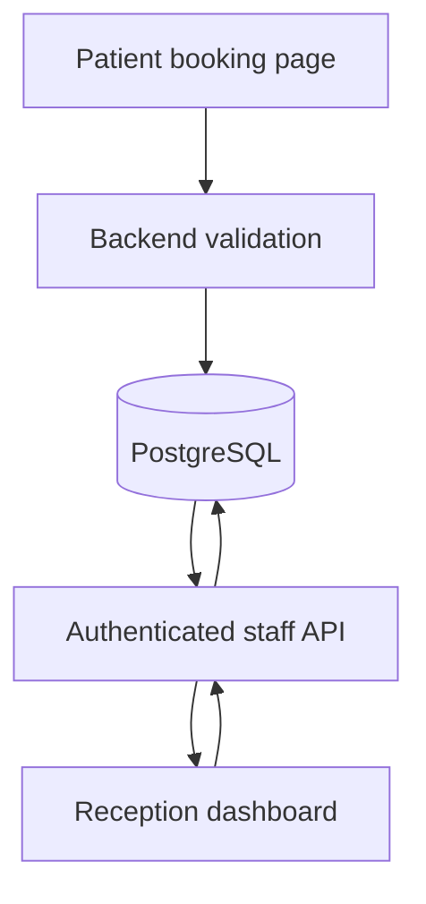

# Architecture notes

## Current demo behavior

The public booking page calls `createPublicBooking`. Without `DATABASE_URL`, it falls back to localStorage in the browser; with `DATABASE_URL`, the Server Action inserts a new patient and booking into PostgreSQL. The dashboard reads/writes localStorage regardless of database configuration. Staff database actions exist but have not been connected to the dashboard.

This means PostgreSQL is **not currently a single source of truth**. A booking inserted in PostgreSQL will not automatically show up on the dashboard.

## Proposed production flow

## Suggested rollout

1. Centralize booking creation, listing, updating, notes, follow-ups and confirmation history in database-backed actions.
2. Authenticate each member of staff and enforce roles on every server action.
3. Use transactions for multi-step writes; avoid accidental duplicate patient records.
4. Add indexes and paginated server filtering once data volume grows.
5. Make WhatsApp confirmation explicit: opening a prepared message is not proof of sending.
6. Add record access controls, audit logs, rate limiting, backup/retention policy and privacy review before real-world use.

## Known engineering limits

- Dashboard uses `readBookings()`/`writeBookings()` from `lib/storage.ts`.
- Public Server Action inserts patient and booking separately, without a transaction.
- `requireStaffSession()` expects a cookie set elsewhere; no login UI is supplied.
- Current demo is single-browser/local-storage-oriented.
- Seed data and dates are fictional demonstration content.
